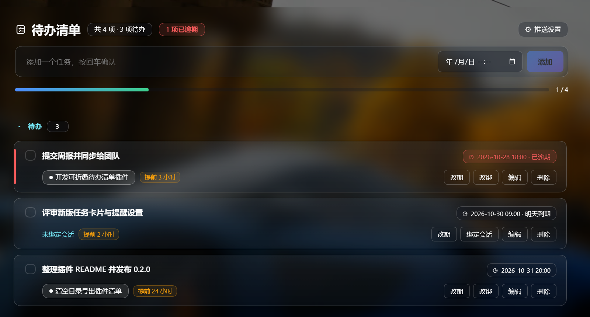
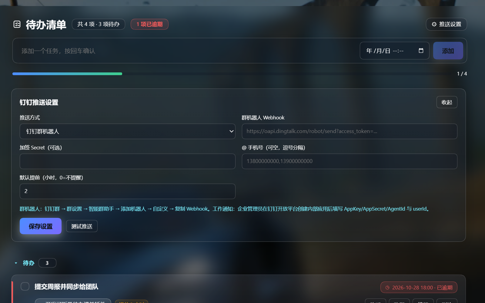

# dsh-todolist

[English](README.md) | [中文](README.zh.md)

A **DeepSeek Harness (DSH)** desktop plugin that adds a **To-do List** panel to the left sidebar. It is a collapsible task list with due dates, per-task workspace-session binding, and one-click jump to the bound session.



## Features

- **Left-nav entry** — a “To-do List” row in the sidebar, next to “Context Insights”.
- **Large task cards** — two-line card layout, status accent bar (overdue red / due-today amber), rounded gradient surfaces, hover lift, and a completion progress bar.
- **Full task lifecycle** — add, edit (double-click or “Edit”), toggle done, delete, clear completed.
- **Due time (hour precision)** — set `YYYY-MM-DD HH:00` when adding, or reschedule any task (“Due / Reschedule”, quick Today 18:00 / Tomorrow 09:00 / In 1 hour, clear). Overdue tasks are highlighted red, due-today amber; open tasks sort by due time.
- **DingTalk reminders** — a global default lead time plus a per-task override (0 = off); pushes N hours before the due time through a DingTalk **group robot webhook** or an **enterprise-app work notice**. DSH must be running (tray) for the scheduler.
- **Workspace-session binding** — bind a task to any session grouped by workspace; a clickable chip jumps straight to that session.
- **Collapsible sections** — “To do” and “Completed” sections can be collapsed, with counts.
- **Persistent** — tasks are stored on the host at `<DSH_HOME>/todolist/todos.json`, so they survive app restarts and are independent of the random web port. Every write keeps `todos.json.bak` plus up to 20 timestamped snapshots under `todolist/backups/`.
- **Bilingual** — built-in Chinese / English UI strings.

## Requirements

- DSH NEXT 2.0.20 (or a compatible 0.2.x release).
- Windows + PowerShell for the install script (manual installation is also possible).

## Install

```powershell
git clone https://github.com/stitchmaps/dsh-todolist.git
cd dsh-todolist
pwsh -File .\install.ps1
```

The script:

1. copies this repository's plugin files into `%DSH_HOME%\profiles\desktop\node_modules\todolist`;
2. records a `file:` dependency in the profile `package.json`;
3. appends a loader row to the profile `cordis.patch.yml`.

Every modified file is backed up next to the original with a timestamp. Refresh the Web GUI (`Ctrl+R`) if the entry does not appear immediately.

Manual install: copy the package into the profile `node_modules`, then add

```yaml
- insert:
    - id: todolist
      name: todolist
```

to `~/.dsh/profiles/desktop/cordis.patch.yml`.

## Usage

1. Click **To-do List** in the left sidebar.
2. Type a task and press Enter (or “Add”); the date picker next to the input sets an optional due date.
3. On a task card:
   - **Due / Reschedule** — choose a date and hour, use quick Today 18:00 / Tomorrow 09:00 / In 1 hour, set the reminder lead time, or clear it.
   - **Bind session** — pick a session grouped by workspace, then click the session chip to jump to it.
   - **Edit** — rename (or double-click the title).
   - checkbox — toggle completion; **Delete** removes the task.

### DingTalk reminders

1. Click **Push settings** (top-right of the panel).
2. Pick a mode:
   - **Group robot**: paste the DingTalk custom-robot webhook (group → Settings → Smart group assistant → Add robot → Custom). Optionally fill the signing secret and `@` mobile numbers.
   - **Work notice**: fill AppKey / AppSecret / AgentId / recipient userIds from an internal app created on the DingTalk Open Platform.
3. Set a default lead time in hours (0 = no reminder), click **Save settings**, then **Send test** to verify.
4. Per-task override: open a task's due dialog and pick a reminder lead time (default / off / 1–48h).

Credentials are stored locally in `<DSH_HOME>/todolist/todos.json`. A group robot posts to the group; a work notice goes to the individual.



## How it works

DSH plugins have two halves:

- **Browser half** (`lib/client.js`) is loaded by the DSH web module loader. It registers:
  - `sidebar.panellist` — the sidebar entry (`id: todolist`);
  - the `main` keyed slot — the full panel.
  Session data comes from the slot runtime's `useWorkspaces()` / `useSessions()` hooks; jumping uses `ctx.get('uiWorkspace').openSession(sessionId)`.
- **Host half** (`lib/index.js`) is a plain Cordis plugin. It registers `POST /api/todolist/state` through `connection.fetch.register`, reads/writes `<DSH_HOME>/todolist/todos.json` atomically, and runs a 60-second reminder scheduler that pushes to DingTalk N hours before a due time.

The browser bundle is hand-written in the same lazy-CJS factory format as official UI plugins (`window.__ModuleLoader__.load({ id, factory })`), so **no build step is needed**.

## Repository layout

```
.
├─ package.json             # main = host half, ./client = browser half, dsh.client
├─ cordis.patch.yml         # bundle patch: inserts the plugin row
├─ icon.svg
├─ lib/
│  ├─ index.js              # host half: persistence + POST /api/todolist/state
│  └─ client.js             # browser half: sidebar entry + main panel
├─ install.ps1
├─ README.md / README.zh.md
├─ LICENSE
├─ docs/panel.png
└─ docs/panel-settings.png
```

## Notes

- The screenshot uses sample data.
- This is a UI plugin: it does not register any model-facing tool or prompt content.
- The data model is `{ version: 2, tasks: [{ id, title, done, due: 'YYYY-MM-DDTHH:00' | null, remindHours: number | null, remindedAt, reminderDue, sessionId, sessionTitle, createdAt, updatedAt }], config: { dingtalk: {...}, defaultRemindHours } }`.
- Backups: `<DSH_HOME>/todolist/todos.json.bak` (previous version) and `<DSH_HOME>/todolist/backups/todos-YYYYMMDD-HHmmss.json` (last 20 writes). If the main file is missing or corrupt, the host falls back to the newest backup on read.

## License

MIT — see [LICENSE](LICENSE).
